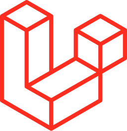

<h3>Languages</h3>

  <a href="https://www.typescriptlang.org/" target="_blank" rel="noreferrer">&nbsp;<b>TypeScript</b></a>&emsp;
  <a href="https://developer.mozilla.org/en-US/docs/Web/JavaScript" target="_blank" rel="noreferrer">&nbsp;<b>JavaScript</b></a>&emsp;
  <a href="https://www.w3.org/html/" target="_blank" rel="noreferrer">&nbsp;<b>HTML</b></a>&emsp;
  <a href="https://www.w3schools.com/css/" target="_blank" rel="noreferrer">&nbsp;<b>CSS</b></a>&emsp;
  <a href="https://www.php.net" target="_blank" rel="noreferrer">&nbsp;<b>PHP</b></a>

<h3>Framework & Library</h3>

  <a href="https://vuejs.org/" target="_blank" rel="noreferrer">&nbsp;<b>Vue.js</b></a>&emsp;
  <a href="https://reactjs.org/" target="_blank" rel="noreferrer">&nbsp;<b>React</b></a>&emsp;
  <a href="https://nuxtjs.org/" target="_blank" rel="noreferrer">&nbsp;<b>Nuxt.js</b></a>&emsp;
  <a href="https://nodejs.org" target="_blank" rel="noreferrer">&nbsp;<b>Node.js</b></a>&emsp;
  <a href="https://expressjs.com" target="_blank" rel="noreferrer">&nbsp;<b>Express.js</b></a>&emsp;
  <a href="https://laravel.com/" target="_blank" rel="noreferrer">&nbsp;<b>Laravel</b></a>

<h3>Database</h3>

  <a href="https://www.mysql.com/" target="_blank" rel="noreferrer">&nbsp;<b>MySQL</b></a>&emsp;
  <a href="https://www.mongodb.com/" target="_blank" rel="noreferrer">&nbsp;<b>MongoDB</b></a>&emsp;
  <a href="https://aws.amazon.com/dynamodb/" target="_blank" rel="noreferrer">&nbsp;<b>DynamoDB</b></a>&emsp;
  <a href="https://redis.io/" target="_blank" rel="noreferrer">&nbsp;<b>Redis</b></a>&emsp;
  <a href="https://aws.amazon.com/elasticache/" target="_blank" rel="noreferrer">&nbsp;<b>ElastiCache (Valkey)</b></a>

<h3>Cloud / Infrastructure</h3>

  <a href="https://aws.amazon.com/" target="_blank" rel="noreferrer">&nbsp;<b>AWS</b></a>&emsp;
  <a href="https://aws.amazon.com/cdk/" target="_blank" rel="noreferrer"><picture><source media="(prefers-color-scheme: dark)" srcset="./img/aws-cdk-dark.svg" /></picture>&nbsp;<b>AWS CDK</b></a>&emsp;
  <a href="https://www.serverless.com/framework" target="_blank" rel="noreferrer">&nbsp;<b>Serverless Framework</b></a>&emsp;
  <a href="https://www.docker.com/" target="_blank" rel="noreferrer">&nbsp;<b>Docker</b></a>

<h3>Development Tools</h3>

  <a href="https://github.com/features/actions" target="_blank" rel="noreferrer">&nbsp;<b>GitHub Actions</b></a>&emsp;
  <a href="https://aws.amazon.com/codepipeline/" target="_blank" rel="noreferrer">&nbsp;<b>CodePipeline</b></a>&emsp;
  <a href="https://biomejs.dev/" target="_blank" rel="noreferrer">&nbsp;<b>Biome</b></a>&emsp;
  <a href="https://mise.jdx.dev/" target="_blank" rel="noreferrer">&nbsp;<b>mise</b></a>&emsp;
  <a href="https://github.com/anthropics/claude-code" target="_blank" rel="noreferrer">&nbsp;<b>Claude Code</b></a>

  
  &nbsp;
  

